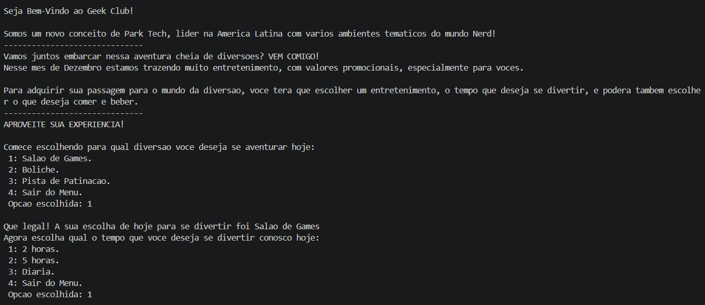
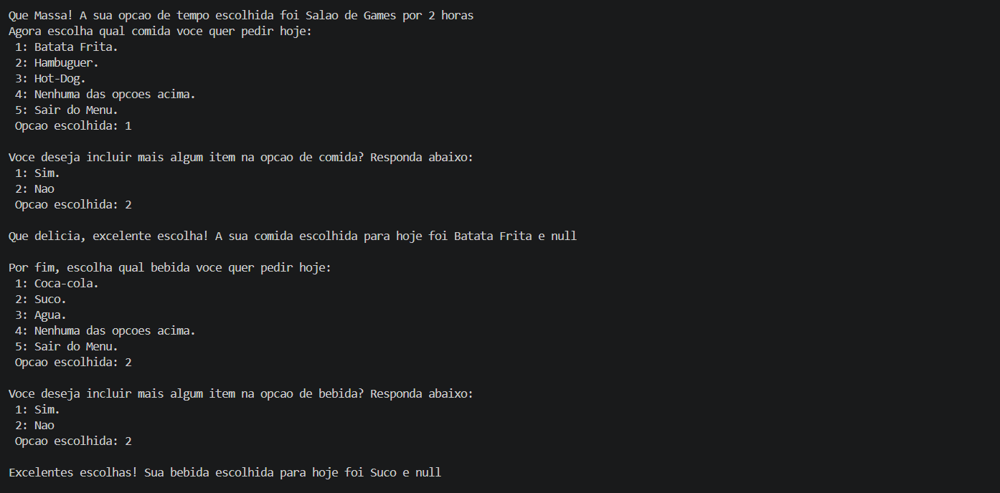
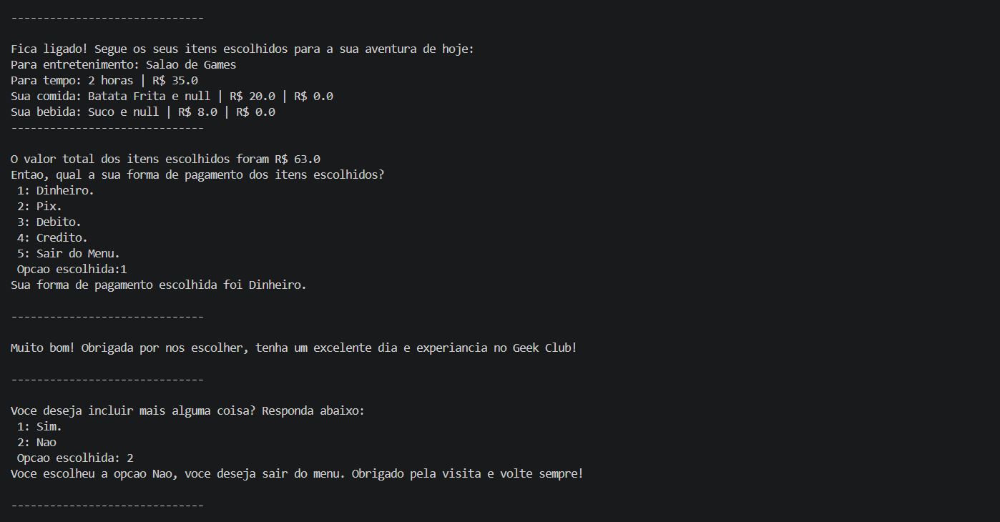

<div align="center">

  

# Geek Club - Menu em Java

**Sistema interativo de entretenimento para praticar Java.**  
*Aprende estruturas de dados e POO enquanto constrói um menu funcional.

[](#%EF%B8%8F-stack)

</div>

---

## 📑 Sumário

- [O que é isso](#-o-que-é-isso)
- [Resultado do Projeto](#-resultado-do-projeto)
- [Tecnologias](#-tecnologias)
- [Estrutura](#-estrutura)
- [Requisitos do Projeto](#-requisitos-do-projeto)
- [Instruções de Uso](#-instruções-de-uso)
- [Créditos](#-créditos)
- [Autora](#-autora)

---

## 🎯 O que é isso

Esse foi o meu `Primeiro Projeto na Programação`e também no `Back End`. Foi também um projeto de encerramento da disciplina de **Estrutura de Dados** e **Programação Orientado a Objetos**, ensinada na `Linguagem Java`, com enfoque na usabilidade de elementos para fomentar o conhecimento nessa linguagem de programação.
  
## ✨ Resultado do Projeto





  
## 🛠️ Tecnologias
  
| Linguagens de Programação | Ferramentas e Tecnologias |
| :-----------------: | :-----------------------: |
|  | 

---

## 📁 Estrutura

```
geekclub-java/
├── README.md                 # Documentação do projeto
├── App.java/                 # Pasta principal do projeto
│   ├── bin/                  # Arquivos compilados (.class)
│   └── src/
│       └── App.java          # Arquivo principal com o programa completo
└── img/                      # Imagens e recursos visuais
    ├── logo.png
    ├── image-1.png
    ├── image-2.png
    └── image-3.png
```

**Descrição:**
- **App.java/** - Diretório que contém o código fonte Java e binários compilados
- **src/** - Pasta com os arquivos `.java` do projeto
- **bin/** - Pasta gerada automaticamente com os arquivos `.class` compilados
- **img/** - Armazena as imagens da documentação e visual do projeto
  
## 🗒️ Requisitos do Projeto
  
> Projeto - Sistema de Entretenimento
  
Crie um programa em Java que gerencie um sistema de entretenimento para pessoas. Este sistema deve ter um menu para oferecer opções de lugares para diversão, para comer e beber (pode ter mais coisas, tipo transporte). Cada opção deve ter seu preço. Após captar todos os desejos do usuário, informe quanto deu sua conta total.

#### Implementação do Geek Club:
- **Diversões:** Salão de Games, Boliche, Pista de Patinação
- **Comidas:** Batata Frita, Hambúrguer, Hot-Dog
- **Bebidas:** Coca-Cola, Suco, Água
- **Tempos:** 2 horas (R$ 35), 5 horas (R$ 75), Diária (R$ 100)
- **Pagamento:** Dinheiro, PIX, Débito, Crédito

#### Especificações de conteúdo:
- Indique um nome para seu negócio.
- Sua composição de diversão/comida/bebida tem que combinar (fazer sentido).
- O programa deve exibir inicialmente um texto explicando do que se trata seu sistema, após apresentar as primeiras opções ao usuário.
- O sistema só captura uma informação de diversão, uma de comida e uma de bebida.
- Utilizar pelo menos 3 opções de cada seção.
- A saída deve exibir qual a diversão, a bebida e a comida escolhidas, além do preço total.

#### Especificações técnicas:
- Todos os dados são capturados pelo console (entrada do usuário).
- Exibir mensagens apropriadas a cada situação (você tem que interagir com o usuário).
- O usuário tem a opção de não escolher nada.
- Utilizar inteiros para a escolha dos itens:
`(1) Pepsi`
`(2) Fanta`
`(3) Coca-cola`
- Utilizar pelo menos uma variável:
`String`
`Int`
`Double`
- Utilizar estruturas como:
`if / else`
`if / else if / else`
`switch (opcional)`
  
### ▶️ Instruções de Uso

1. Clone ou baixe este repositório para a sua máquina local.

2. Certifique-se de ter o [Java Development Kit (JDK)](https://www.oracle.com/br/java/technologies/downloads/) instalado na sua máquina e a extensão [Java Extension Pack](https://code.visualstudio.com/docs/java/extensions) instalado no VS Code.

3. Abra o terminal e navegue até o diretório do projeto (pasta `App.java`).

4. Compile o programa Java com encoding UTF-8:
```bash
javac -encoding UTF-8 src/App.java
```

5. Execute o programa:
```bash
java -cp src App
```

**Nota:** O arquivo compilado será gerado na pasta `src/`. Certifique-se de estar no diretório correto antes de executar os comandos.
  
## 🔗 Créditos
Este projeto foi desenvolvido como parte de avaliação das disciplinas de `Estrutura de Dados` e `Programação Orientado a Objetos`, para avaliar o ensinado em sala, sobre os fundamentos básicos aplicados na Linguagem `Java`.

*Nota: Este projeto é apenas para fins educacionais e não possui nenhuma afiliação oficial.*
  
---

## 👩🏼‍💻 Autora

<table>
  <tr>
    <td align="left">
      <a href="https://github.com/rhayssakramer">
        <strong>Rhayssa Kramer</strong>
      </a>
      <br>
      <span>Assoc, Full-Stack Development</span>
      <br>
      <small>Avanade | Tech Content Creator | Community Speaker</small>
    </td>
  </tr>
</table>

---

<div align="center">

### ⭐ Se este projeto foi útil, considere deixar uma estrela no GitHub!

© 2026 Rhayssa Kramer. Todos os direitos reservados.

<a href="https://github.com/rhayssakramer"></a>

</div>
